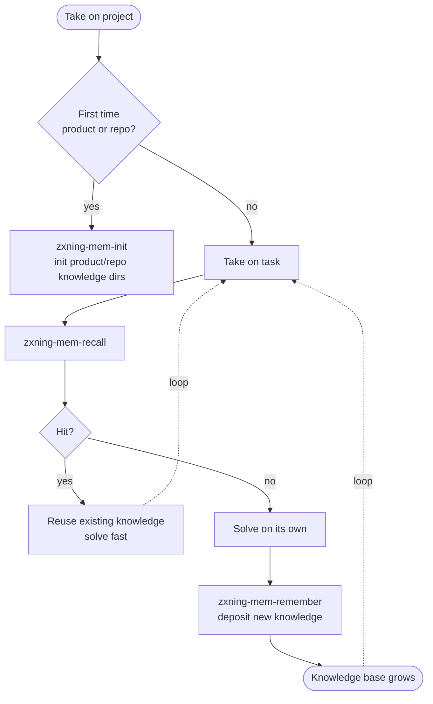

# zxning-agent-knowledge

> English | [中文](./README.zh.md)

A personal knowledge base. It records project experience, technical decisions, incident post-mortems, and other knowledge for AI agents to retrieve on demand — the more you use it, the smarter it gets.

## Why You Need It

Every time an agent takes on a task, it starts from zero knowledge of the project. The same pitfalls get hit again and again, the same decisions get re-made. This knowledge base lets the agent retrieve existing knowledge before acting, avoiding repeated exploration; after completing a task it automatically deposits new knowledge, making the next round faster.



## Quick Start

### 0. Clone the knowledge base

> This is a private repository — make sure you have access.

```bash
git clone git@github.com:ningzuoxin/zxning-agent-knowledge.git
```

### 0.5 Configure the environment variable (knowledge data root)

Knowledge data lives in a separate data repo, `zxning-agent-knowledge-vault` (side by side with this tool repo), pointed to by an environment variable. All skills' write / retrieve / init operations happen under that directory:

```powershell
setx ZXNING_AGENT_KNOWLEDGE_VAULT "D:\workspaces\zxning\zxning-agent-knowledge-vault"
```

> You can also add it via the GUI ("System Properties → Environment Variables → User Variables") — fully equivalent. Restart terminals / IDEs after setting for it to take effect.

### 1. One-command skill installation (codebuddy / trae / copilot)

Run at the tool repo root (use git-bash on Windows):

```bash
cd /d/workspaces/zxning/zxning-agent-knowledge

bash bootstrap.sh                  # Default: install to CodeBuddy + Trae (global, one shot)
bash bootstrap.sh codebuddy        # CodeBuddy only
bash bootstrap.sh trae             # Trae only
bash bootstrap.sh copilot          # Current project's .agents/skills/ (GitHub Copilot, project-level)
bash bootstrap.sh <any-directory>  # Custom directory
```

Install targets (all verified against the actual skill scan directories on this machine):

| Target | Directory | Scope |
| --- | --- | --- |
| codebuddy | `~/.codebuddy/skills/` | Global |
| trae | `~/.trae-cn/skills/` | Global (Trae-CN; the international `.trae` does not apply) |
| copilot | `<current project>/.agents/skills/` | Project-level (run at the business repo root) |

Installation only affects the skills themselves; at runtime the agent locates knowledge data via `ZXNING_AGENT_KNOWLEDGE_VAULT` (see 0.5).

### 2. Configure AGENTS.md

Create an `AGENTS.md` at the root of the current working project, pick the example matching your runtime environment, and adjust `product` and `repo`.

> Skills only need to be installed once. Switching projects afterwards only requires **re-configuring AGENTS.md** (change `product` and `repo`).

#### Non-container example (demo-product API service project, running on the host)

```markdown
---
knowledge_base_path: D:\workspaces\zxning\zxning-agent-knowledge-vault
product: demo-product
repo: api
---

# Agent Guide

This project maps to the demo-product/api knowledge base.

## Knowledge Base Usage

If skills are installed, prefer calling the corresponding skill; otherwise follow this direct-read flow:

- **Retrieve knowledge**: read `D:\workspaces\zxning\zxning-agent-knowledge-vault/demo-product/INDEX.md` for the product structure; read `D:\workspaces\zxning\zxning-agent-knowledge-vault/demo-product/api/INDEX.md` to match entries by summary/tags/type; read `D:\workspaces\zxning\zxning-agent-knowledge-vault/demo-product/moc/INDEX.md` for cross-repo knowledge — when the moc hits, follow the markdown links in its "References" section to read the linked repo entries in full.
- **Deposit knowledge**: write `demo-product/api/YYYYMMDD-slug.md` or `demo-product/moc/` per the frontmatter schema (see DESIGN.md chapter 2), and update the corresponding INDEX.md. Cross-repo knowledge goes to `demo-product/moc/`.
- **Initialize**: when a product/repo is onboarded for the first time, create the product directory, repo directory, moc directory, and their INDEX.md files.
```

> Note: `knowledge_base_path` is the fallback; when the `ZXNING_AGENT_KNOWLEDGE_VAULT` environment variable is configured, it takes precedence (priority rules in the tool repo's AGENTS.md).

#### Container example (demo-product API service project, running in Docker)

Prerequisite: mount the **data repo** directory to `/knowledge` in the container and set the environment variable inside the container (`docker run -e ZXNING_AGENT_KNOWLEDGE_VAULT=/knowledge ...`).

```markdown
---
knowledge_base_path: /knowledge     # in-container mount path, the same for all projects
product: demo-product                        # differs per project
repo: api                           # differs per project
knowledge_conflict:
  strategy: jaccard
  threshold: 0.3
---

# Agent Guide

This project maps to the demo-product/api knowledge base.

## Knowledge Base Usage

If skills are installed, prefer calling the corresponding skill; otherwise follow this direct-read flow:

- **Retrieve knowledge**: read `/knowledge/demo-product/INDEX.md` for the product structure; read `/knowledge/demo-product/api/INDEX.md` to match entries by summary/tags/type; read `/knowledge/demo-product/moc/INDEX.md` for cross-repo knowledge
- **Deposit knowledge**: write `demo-product/api/YYYYMMDD-slug.md` or `demo-product/moc/` per the frontmatter schema (see DESIGN.md), and update the corresponding INDEX.md
- **Initialize**: when a product/repo is onboarded for the first time, create the product directory, repo directory, moc directory, and their INDEX.md files
```

### 3. Usage

With skills installed + AGENTS.md configured, the agent will automatically, in the working project:

- **Retrieve knowledge**: search the current repo and moc for relevant knowledge fragments when taking on a task
- **Deposit knowledge**: deposit new knowledge after finishing a task — creates entries, updates indexes
- **Create product/repo**: initialize product/repo knowledge directories when onboarding a new product or repo for the first time

In direct-read mode the agent follows the direct-read flow; in skills mode the corresponding skill executes the standardized flow.

## Tests

Dependencies are tracked in `requirements.txt` and installed into a local venv:

```powershell
python -m venv .venv
.venv\Scripts\python.exe -m pip install -r requirements.txt
.venv\Scripts\python.exe -m pytest tests/ -v
```

The suite covers the four skill scripts (init/validate/retrieve/write) plus contract checks that keep the docs, `bootstrap.sh`, and the `skills/` directory in sync.

## Browse the Vault in a Browser

Build a single self-contained HTML page from the vault and open it directly from disk (no server, fully offline):

```powershell
.venv\Scripts\python.exe scripts\build_site.py "D:\path\to\zxning-agent-knowledge-vault"
```

This writes `index.html` next to the data. It offers a product/repo/entry tree, full-text search, type/status filters, and in-page jumps through moc reference links. Rebuild after knowledge changes (or wire it after the doctor step of a write session).

## Skills (Optional Enhancement)

Skills are an optional enhancement to direct-read mode, providing more precise matching, enforced schema validation, and automatic index maintenance. Without them, the agent reads INDEX files and entries directly per AGENTS.md.

| Skill | Purpose | Trigger |
| --------- | ------------------------------------------------ | ---------------------- |
| zxning-mem-recall | Search by query across the current repo and moc, return relevant fragments | agent auto / manual |
| zxning-mem-remember | Deposit knowledge entries; auto-generates frontmatter, updates indexes | agent auto / manual |
| zxning-mem-doctor | Validate knowledge base consistency and integrity; mandatory post-hook of the write chain | auto after write / manual |
| zxning-mem-init | Initialize a new repo knowledge directory under a product (incl. product init) | agent auto / manual |

## Detailed Design

For the directory structure, frontmatter schema, and skills-layer details, see [`DESIGN.md`](./DESIGN.md).
