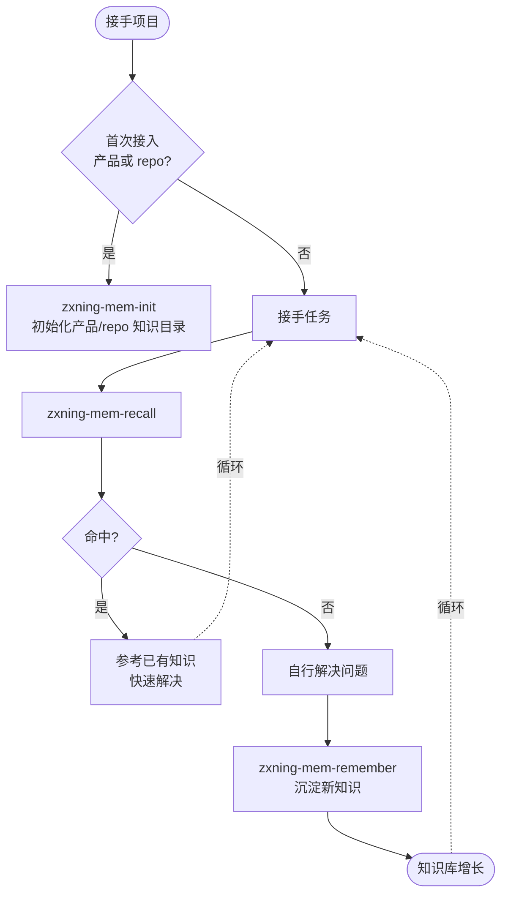

# zxning-agent-knowledge

> [English](./README.md) | 中文

个人知识库。记录项目经验、技术决策、踩坑记录等知识，供 AI agent 按需检索，越用越聪明。

## 为什么需要它

agent 每次接手任务时，对项目的了解从零开始。同样的坑重复踩，同样的决策重复做。这个知识库让 agent 在动手前先检索已有知识，避免重复探索；完成任务后自动沉淀新知识，让下一次更快。



## 快速开始

### 0. 克隆知识库

> 这是私有仓库，确保你有访问权限。

```bash
git clone git@github.com:ningzuoxin/zxning-agent-knowledge.git
```

### 0.5 配置环境变量（知识库数据根）

知识数据存放在独立的数据仓 `zxning-agent-knowledge-vault`（与工具仓并列），由环境变量指向。所有 skills 的写入 / 检索 / 初始化都发生在该目录下：

```powershell
setx ZXNING_AGENT_KNOWLEDGE_VAULT "D:\workspaces\zxning\zxning-agent-knowledge-vault"
```

> 也可在"系统属性 → 环境变量 → 用户变量"图形界面添加，完全等效。配置后需**重开终端 / IDE** 才生效。

### 1. 一键安装 skills（codebuddy / trae / copilot）

在工具仓根目录执行（Windows 用 git-bash）：

```bash
cd /d/workspaces/zxning/zxning-agent-knowledge

bash install.sh                  # 默认：装到 CodeBuddy + Trae（全局，一次到位）
bash install.sh codebuddy        # 只装 CodeBuddy
bash install.sh trae             # 只装 Trae
bash install.sh copilot          # 装到当前项目的 .agents/skills/（GitHub Copilot，项目级）
bash install.sh <任意目录>        # 自定义目录
```

落点对照（均为本机实证的技能扫描目录）：

| 目标 | 目录 | 级别 |
| --- | --- | --- |
| codebuddy | `~/.codebuddy/skills/` | 全局 |
| trae | `~/.trae-cn/skills/` | 全局（Trae-CN；国际版 `.trae` 不适用） |
| copilot | `<当前项目>/.agents/skills/` | 项目级（在业务 repo 根执行） |

安装只影响 skills 本体；agent 运行时靠 `ZXNING_AGENT_KNOWLEDGE_VAULT` 定位知识数据（见 0.5）。

### 2. 配置 AGENTS.md

在当前工作项目根目录创建 `AGENTS.md`，根据运行环境选择对应示例修改 `product` 和 `repo` 即可。

> 安装 skills 只需一次。后续切换项目只需**重新配置 AGENTS.md**（修改 `product` 和 `repo`）。

#### 非容器环境示例（demo-product API 服务项目，宿主机直接运行）

```markdown
---
knowledge_base_path: D:\workspaces\zxning\zxning-agent-knowledge-vault
product: demo-product
repo: api
---

# Agent Guide

本项目对应知识库 demo-product/api。

## 知识库使用方式

若已安装 skills，优先调用对应 skill；否则按以下直读流程：

- **检索知识**：读 `D:\workspaces\zxning\zxning-agent-knowledge-vault/demo-product/INDEX.md` 获取产品结构；读 `D:\workspaces\zxning\zxning-agent-knowledge-vault/demo-product/api/INDEX.md` 按 summary/tags/type 匹配条目；读 `D:\workspaces\zxning\zxning-agent-knowledge-vault/demo-product/moc/INDEX.md` 检查跨 repo 知识，moc 命中时按"参考条目"中的 markdown 链接读取对应 repo 条目全文。
- **沉淀知识**：按 frontmatter schema（见 DESIGN.md 第二章）写入 `demo-product/api/YYYYMMDD-slug.md` 或 `demo-product/moc/`，并更新对应 INDEX.md。多 repo 知识写入 `demo-product/moc/`。
- **初始化**：产品/repo 首次接入时，创建产品目录、repo 目录、moc 目录与对应 INDEX.md。
```

> 提示：`knowledge_base_path` 是回退值；已配置环境变量 `ZXNING_AGENT_KNOWLEDGE_VAULT` 时以环境变量为准（优先级规则见工具仓 AGENTS.md）。

#### 容器环境示例（demo-product API 服务项目，Docker 运行）

前置条件：在宿主机上将**数据仓**目录挂载到容器的 `/knowledge` 目录，并在容器内设置环境变量（`docker run -e ZXNING_AGENT_KNOWLEDGE_VAULT=/knowledge ...`）。

```markdown
---
knowledge_base_path: /knowledge     # 容器内挂载路径，所有项目统一
product: demo-product                        # 每个项目的 product 不同
repo: api                           # 每个项目的 repo 不同
knowledge_conflict:
  strategy: jaccard
  threshold: 0.3
---

# Agent Guide

本项目对应知识库 demo-product/api。

## 知识库使用方式

若已安装 skills，优先调用对应 skill；否则按以下直读流程：

- **检索知识**：读 `/knowledge/demo-product/INDEX.md` 获取产品结构；读 `/knowledge/demo-product/api/INDEX.md` 按 summary/tags/type 匹配条目；读 `/knowledge/demo-product/moc/INDEX.md` 检查跨 repo 知识
- **沉淀知识**：按 frontmatter schema（见 DESIGN.md）写入 `demo-product/api/YYYYMMDD-slug.md` 或 `demo-product/moc/`，并更新对应 INDEX.md
- **初始化**：产品/repo 首次接入时，创建产品目录、repo 目录、moc 目录与对应 INDEX.md
```

### 3. 使用

安装 skills + 配置 AGENTS.md 后，agent 在工作项目中即可自动：

- **检索知识**：接手任务时检索知识，在当前 repo 和 moc 中搜索相关知识片段
- **沉淀知识**：完成任务后沉淀新知识，生成条目、更新索引
- **新建产品/repo**：首次接入新产品或新 repo 时初始化产品/repo 知识目录

直读模式下由 agent 按直读流程执行；skills 模式下由对应 skill 标准化执行。

## 测试

依赖统一记录在 `requirements.txt`，安装到本地 venv 中使用：

```powershell
python -m venv .venv
.venv\Scripts\python.exe -m pip install -r requirements.txt
.venv\Scripts\python.exe -m pytest tests/ -v
```

测试覆盖四个 skill 脚本（init/validate/retrieve/write），以及文档、`install.sh` 与 `skills/` 目录一致性的契约检查。

## 浏览器浏览知识库

用一条命令把 vault 构建成单个自包含 HTML 页面，双击即可打开（无需服务器，完全离线）：

```powershell
.venv\Scripts\python.exe scripts\build_site.py "D:\path\to\zxning-agent-knowledge-vault"
```

生成 `index.html`（与数据放在一起），提供 product/repo/条目树、全文搜索、type/status 过滤，以及 moc 参考链接的页内跳转。remember skill 每次写入知识后会自动重建（Step 8）；直接手改条目文件时，手动执行一次上面命令即可。

## Skills（可选增强）

skills 是直读模式的可选增强，提供更精准的匹配、schema 强制校验与索引自动维护。未安装时 agent 按 AGENTS.md 指引直读 INDEX 与条目。

| Skill     | 用途                                             | 触发方式               |
| --------- | ------------------------------------------------ | ---------------------- |
| zxning-mem-recall    | 在当前 repo 和 moc 中按 query 搜索，返回相关片段 | agent 自动 / 手动      |
| zxning-mem-remember       | 沉淀知识条目，自动生成 frontmatter、更新索引     | agent 自动 / 手动      |
| zxning-mem-doctor    | 校验知识库一致性与完整性，是写入链的强制后置钩子 | zxning-mem-remember 自动 / 手动 |
| zxning-mem-init | 在产品下初始化新 repo 知识目录（含产品初始化）   | agent 自动 / 手动      |

## 详细设计

目录结构、frontmatter schema、skills 层详细设计见 [`DESIGN.md`](./DESIGN.md)。
